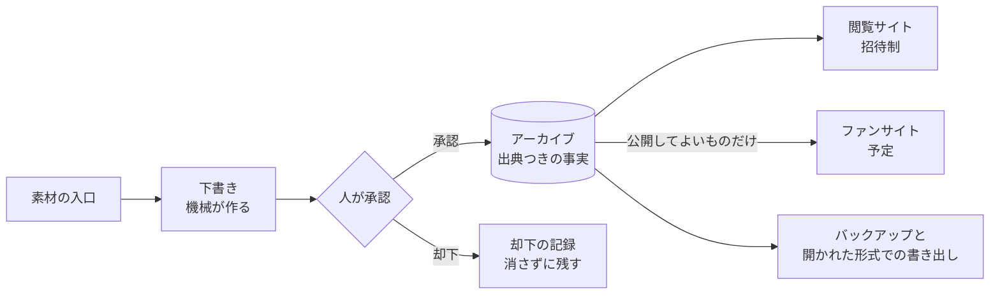

# 大野愛実アーカイブ

日向坂46・大野愛実さんの活動を、出典つきの事実として残していくアーカイブプロジェクトです。

## 目指していること

**目的**: 大野愛実に関する情報を、すべてアーカイブする

**目指す姿**: 大野愛実の活動が、検索しやすく整理された健全なデータベースとして長く保たれている状態。本人がいつか振り返ったときに「こんな活動をしていたな」と思い返せる、素敵な記録であること。そして将来は、ファンサイトとして多くの人に開かれていること。

### 2 本の柱

| 順位 | 柱 |
|---|---|
| 第一 | 本人の発言と、メンバーからの言及の集積 |
| 第二 | 仕事の記録（テレビ・雑誌・ランウェイ・ドラマ・ラジオ・CM・ライブなど） |

## 大事にしていること

1. **網羅性** — 漏れなく残すことを目指す。どこまで集められているかを把握できる状態を保つ
2. **客観的な事実の蓄積** — 何が・いつ・どこで・出典は何かを記録する。感想や解釈は、事実とは別の層に置いて混ぜない
3. **検索性** — 表記ゆれまで含めて、あとから素早く見つけられるようにする
4. **データベースの健全性** — 一時的に動くことより、長く正しく保たれることを優先する
5. **本人が見ても嬉しい記録であること** — プライバシーを尊重し、本人の意向を最優先する
6. **公開と非公開を明確に分ける** — 公開してよい情報だけが外に出る仕組みにする。有料コンテンツなど、広めてはいけないものは公開しない

## 仕組み

### 設計の考え方

- **取り込みは承認制**: 機械は下書きを作るだけで、人が承認したものだけがアーカイブに入る
- **事実には必ず出典**: 事実と解釈を分け、ファンの推測は事実として扱わない
- **公開区分を仕組みで守る**: すべてのデータが「公開」か「非公開」を持つ。設定し忘れたものは非公開になる
- **有料の情報源の原文は広めない**: 有料の素材そのものは公開しない。そこから分かる事実は、原文を再現できない形でのみ使う
- **AI は基本的に使わない**: 振り分けや提案は決まった規則で行い、規則で決められないものは人が判断する
- **長く残る形で持つ**: データは開かれた形式でも書き出し、バックアップは復元できることまで確かめる
- **小さな費用で続ける**: 無料枠と従量課金で収まる構成を選ぶ
- **仕組みは汎用に**: 人物・情報源・語彙はプログラムに書かず、データとして持つ

## 今の状態（2026 年 10 月）

**できていること**

- データベース（公開区分・全文検索・変更履歴・自動テスト）
- 承認制の取り込みと、承認・却下・保留の処理
- 素材のファイルの保存
- 投稿の入口になる Bot の土台
- 閲覧サイト（招待制）

**これから**

- バックアップの稼働と、復元の確認
- これまで集めてきた記録の移行
- 記録の漏れを見つける仕組み
- ファンサイトとしての公開

## リポジトリ

| リポジトリ | 内容 |
|---|---|
| [aletheia](https://github.com/Oto-Manami/aletheia) | アーカイブの本体（データベース・取り込み・Bot・閲覧サイト）。公開しています |

開発への参加は、[aletheia の参加ガイド](https://github.com/Oto-Manami/aletheia/blob/main/CONTRIBUTING.md)をご覧ください。

このリポジトリは公開されています。編集は運営者が行います。

---

設計の一部は、[世界新奈プロジェクト](https://github.com/sekai-nina/sekai-nina-project)を参考にしています。
